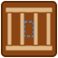
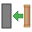
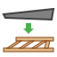
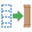

# TimberFrame — a FreeCAD workbench for turning BIM into timber framing

Convert BIM walls, slabs and single-slope roofs drawn in FreeCAD's Arch /
BIM workbench into real, geometrically-accurate timber frames (studs,
plates, joists, rafters, battens, headers). Automatic opening framing
(windows / doors / skylights), cut lists, blueprints, and one-click
scaled 3MF export for 3D-printing architectural models.

Built by someone who was tired of drawing every stud by hand.



---

## What it does

Give it a BIM wall / slab / roof and it gives you a timber frame:

| Input (Arch/BIM) | Output (TimberFrame) |
|---|---|
| **Wall** (any Align: Left/Right/Center, straight or multi-segment, flat or sloped-top from a roof subtraction) | Studs + top/bottom plates + sloped head beam, properly framed around every window and door |
| **Slab** (floor) | Rim joists + joists + end joists, rotated to the slab's local axes, joists span the shorter dimension by default |
| **Roof** (single-slope / shed, with flat-roof fallback) | Wall plate + ridge plate + rake plates + rafters + optional tile battens with air gap |

The original BIM object is **hidden** after conversion so the frame
*replaces* it in the model. A `Regenerate Frame` command re-runs the
conversion in place — change the wall's height, add a window, flip the
roof pitch, hit regenerate, done.

For modelmakers: **Export for 3D Printing** fuses the whole frame, scales
it (1:30, 1:50, your choice), and writes a `.3mf` ready for the slicer.

---

## Supported FreeCAD versions

- **FreeCAD 1.1** (primary target, used daily).
- **FreeCAD 1.0** should work but is not routinely tested.
- Older than 1.0 is not supported (the plugin relies on
  `App::MaterialObject`-era behaviour and modern Arch properties).

The plugin uses only standard FreeCAD modules: `Part`, `Sketcher`,
`Mesh`, `MeshPart`, `TechDraw`, `Draft`, plus `PySide` for the GUI. No
external Python packages, no network access.

---

## Install

Clone this repo into your FreeCAD user mod directory. On FreeCAD 1.1
Windows that's:

```
%APPDATA%\FreeCAD\v1-1\Mod\TimberFrame\
```

On Linux: `~/.local/share/FreeCAD/Mod/TimberFrame/`
On macOS: `~/Library/Application Support/FreeCAD/Mod/TimberFrame/`

```bash
cd <mod directory>
git clone https://github.com/gomulius/Timber-Frame.git TimberFrame
```

Restart FreeCAD → **View → Workbench → Timber Frame**.

Make sure the Arch/BIM workbench is also installed (it ships with
FreeCAD) — you need it to draw the walls/slabs/roofs that TimberFrame
converts.

---

## The toolbar / menu

| Icon | Command | What it does |
|---|---|---|
|  | **Convert Wall to Frame** | Selected BIM wall(s) → stud frame |
|  | **Convert Slab to Frame** | Selected BIM slab(s) → floor platform |
|  | **Convert Roof to Frame** | Selected BIM roof(s) → rafter frame |
|  | **Regenerate Frame** | Rebuild a frame from its source after you changed the source's properties |
|  | **Edit Frame Layout** | Open the stud sketch of a wall frame for hand-tweaking |
|  | **Rebuild Frame from Sketch** | Rebuild the 3D members from the edited stud sketch |
|  | **Generate Blueprint** | TechDraw page with the correct view (elevation for walls, plan for floors, etc.) |
|  | **Generate Cut List** | Spreadsheet grouping every piece by type + size + length |
|  | **Export for 3D Printing (3MF)** | Fuse + scale + mesh + write .3mf |
|  | **Settings** | Edit wall / floor / roof defaults for this session |

---

## Walkthrough

### Converting a wall

1. Draw an Arch Wall as usual (sketch-based, with its `Align` set to
   whatever matches your intent).
2. (Optional) Add Arch Windows and Doors hosted by the wall.
3. (Optional) Shorten the wall top with the roof's "Remove Component"
   so a sloped-top wall gets a sloped top plate.
4. Select the wall → **Convert Wall to Frame**.
5. Dialog: stud width/depth, stud spacing (default 500 mm — European
   insulation panels), plate count, header rule-of-thumb, king/jack/
   cripple studs on/off. OK.
6. A `Frame_<wall>` group appears with the full frame. The original
   wall is hidden.

The header depth is **not** a fixed setting — the plugin uses the usual
rule of thumb for light timber framing:

- Up to ~1.0 m span → **2× stud** header (~90 mm high)
- Up to ~1.5 m span → **3× stud** (~135 mm)
- Up to ~2.0 m span → **4× stud** (~180 mm)
- Larger spans emit a warning: engineered lumber (LVL) or steel needed.

### Converting a floor slab

1. Draw an Arch Slab (floor).
2. Select → **Convert Slab to Frame**.
3. Dialog: joist width/depth/spacing, rim-joist on/off, joist
   direction (auto = span the shorter side), optional sheathing /
   blocking.
4. Floor platform appears underneath where the slab was; the slab is
   hidden.

### Converting a shed roof

1. Draw an Arch Roof (single pitch — `Angles[0]` set, the other three
   left at defaults; a flat `Angles[0]=0` is handled too).
2. Select → **Convert Roof to Frame**.
3. Dialog:
   - Rafter width / depth / spacing (default 600 mm centres).
   - Perimeter: wall plate (eave), ridge plate, rake plates. All on by
     default so the frame has a complete rectangular border.
   - Battens: spacing + width + thickness. **Always places a batten
     flush with the eave and ridge regardless of spacing** so the
     first/last tile row has a nailing surface.
   - Flat-roof threshold (default 0.5°): any shallower pitch is framed
     as a horizontal joist platform.
4. Multi-slope roofs (gable, hip, …) surface a clear "not yet
   supported" message. Planned for a future phase.

### Regenerate

Change *anything* about the source (wall Align, slab size, roof pitch,
openings, settings) → select the `Frame_*` group in the tree → click
**Regenerate Frame**. The old frame is removed and a fresh one is built
with the latest inputs *in place*. No duplicates in the tree.

Settings used at the time of first conversion are persisted on the
frame group (`TimberSettingsJSON` property) so Regenerate doesn't reset
your choices.

### Cut list

Produces a FreeCAD spreadsheet grouping every piece by:
- Member type (stud, header, joist, rafter, batten, …)
- Cross-section
- Rounded length

So you can walk into a timber yard with a shopping list.

### Blueprint

Picks the right view automatically:
- Floor frames → plan from above
- Walls / roofs along X → elevation looking along −Y
- Walls / roofs along Y → elevation looking along +X
with world +Z always "up" on the page.

TechDraw A3 landscape template; export to PDF/SVG from TechDraw.

### Export for 3D printing

The author uses this plugin to 3D-print architectural models at 1:30
and 1:50. The command bundles the manual steps:

1. Collect every member of the chosen frame group.
2. Fuse them into one solid (`Part.multiFuse`).
3. Scale uniformly from the world origin by `1 / N`.
4. Mesh (default `LinearDeflection=0.1, AngularDeflection=0.3`).
5. Write `.3mf` (or `.stl`) to the path you pick.

No temporary objects remain in the document.

---

## Supported BIM sources — what works today

| | Status |
|---|---|
| Arch Wall, single segment, axis-aligned (X or Y) | ✔ |
| Arch Wall, multi-segment (L / U / closed polygon) | ✔ |
| Arch Wall with roof-subtraction (sloped top) | ✔ |
| Arch Wall, non-axis-aligned (diagonal) | partial — single-segment path uses bounding box |
| Arch Window / Door as a wall opening | ✔ |
| Arch Slab, rectangular | ✔ |
| Arch Slab, non-axis-aligned (rotated in XY) | ✘ — planned step 5 |
| Arch Slab, non-rectangular (L / polygon) | ✘ — planned step 5 |
| Arch Roof, single-slope (shed) | ✔ |
| Arch Roof, flat (≤ threshold deg) | ✔ (via floor builder) |
| Arch Roof, multi-slope (gable / hip / mansard) | ✘ — Phase 3 |
| Hosted skylights / chimneys on a roof | ✘ — Phase 6 |
| Hosted stair / chimney openings on a slab | ✘ — step 4 |

Planned work and design notes live in `docs/`:
- `docs/ROOF_PLAN.md`
- `docs/BASE_AND_ROOF_PLAN.md`
- `docs/SIDING_PLAN.md`

---

## Diagnostic scripts

If something doesn't look right, there are three "paste this one line
in the Python console" helpers that print everything the converter
sees:

```python
exec(open(r".../TimberFrame/diagnose_wall.py").read())
exec(open(r".../TimberFrame/diagnose_slab.py").read())
exec(open(r".../TimberFrame/diagnose_roof.py").read())
```

(Change `WALL_LABEL` / `SLAB_LABEL` / `ROOF_LABEL` at the top of the
file if your object has a different name.)

They dump bounding boxes, placements, sloped-face detection, extracted
openings, and in the slab/roof case the full output of
`extract_slab_data` / `extract_roof_data`. Paste the output into a
GitHub issue and I can usually point to the fix in one round.

---

## License

GNU **GPL‑3.0‑or‑later**. See `LICENSE` for the full text.

In plain language:

- Free to use, copy, run, distribute.
- If you distribute a modified version you **must**:
  - Credit the original (keep the copyright headers, link back to this
    repo).
  - Release your modifications under the same GPL‑3.0+ terms.
  - Make the source code of your modified version available.

This is compatible with FreeCAD itself (LGPL‑2.1+) so the workbench can
live happily inside your FreeCAD install.

---

## Contributing

Bug reports and pull requests welcome. For PRs:

1. Keep changes focused — one feature or one fix per PR, commit history
   matters.
2. Add / update a diagnostic case if the fix was for a tricky BIM input.
3. If you're adding a new conversion type (siding, posts, stairs…),
   drop a short design note under `docs/` first so we can align on the
   data model before writing geometry code.

---

## Credits

- Author: **Raf Urbanski** ([@gomulius](https://github.com/gomulius))
- Developed with heavy pair-programming help from an AI assistant;
  every line was reviewed, tested in FreeCAD, and committed by the
  human.
